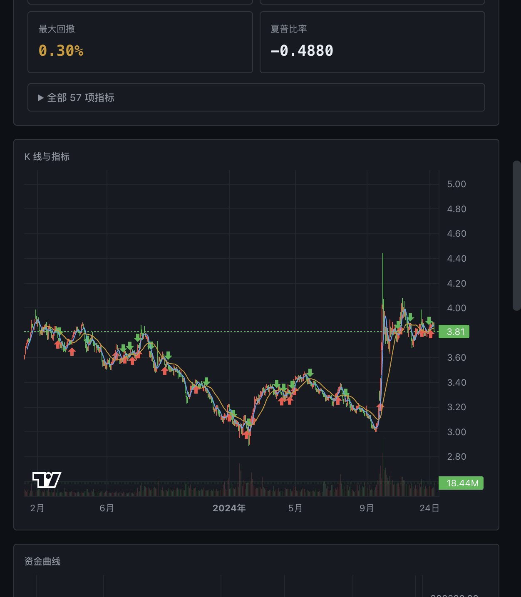

# Hikyuu 回测前端

基于 [Hikyuu](https://hikyuu.org) 量化回测框架的全栈回测工具：React 前端 + FastAPI 后端，
用于 A 股股票与场内 ETF 的日线回测。



## 技术栈

| 层 | 技术 |
| --- | --- |
| 后端 | Python 3.13 · FastAPI · uv · Hikyuu 3.0.0 |
| 前端 | React 19 · Vite 8 · TypeScript · Tailwind CSS 4 · bun |
| 图表 | lightweight-charts 5（K 线 / 资金曲线） |
| 存储 | Hikyuu HDF5（K 线）+ SQLite（证券元信息） |

## 快速开始

### 1. 后端

```bash
cd backend

# PyPI 直连很慢，务必配置镜像
export UV_INDEX_URL="https://pypi.tuna.tsinghua.edu.cn/simple"

uv sync
```

> `pyproject.toml` 里用 `[tool.uv] exclude-dependencies` 剔除了 Hikyuu 的
> PySide6 依赖（435MB Qt GUI 框架，服务端用不上），安装后虚拟环境约 612MB。
> 注意 Hikyuu 的 GUI 子模块将无法导入，核心回测 API 不受影响。

导入行情数据（首次必做）：

```bash
uv run python scripts/seed_data.py --symbols sh510300,sh510500
```

启动服务：

```bash
uv run uvicorn app.api.server:app --reload --port 8000
```

### 2. 前端

```bash
cd frontend
bun install
bun run dev
```

打开 http://localhost:5173 。Vite 已配置代理，`/api` 自动转发到 `127.0.0.1:8000`。

## 功能

- **标的**：本地已导入的 ETF / 指数清单
- **信号**：双均线交叉、单均线，或 `backend/strategies/*.py` 自定义脚本
- **资金管理**：固定股数、固定比例
- **费率**：内置 A 股费率模型（股票 2015 前 / 2017 起 / ETF / 零费用）
- **风控**：止损、止盈、滑点
- **指标叠加**：MA / EMA / RSI / MACD
- **输出**：K 线图（成交量 + 买卖点）、资金曲线、57 项绩效指标、成交明细

## 项目结构

```
backend/
  app/
    core/engine.py      Hikyuu 3.0 API 适配层（隔离版本差异）
    core/strategy_loader.py  自定义策略脚本加载（按 mtime 热更新）
    data/sources.py     行情数据源适配（akshare / 腾讯指数源）
    data/importer.py    HDF5 写入 + SQLite 注册
    data/bootstrap.py   数据初始化与增量更新
    api/server.py       FastAPI 应用与作业队列
  strategies/           自定义策略脚本（*.py，见其 README）
  scripts/
    seed_data.py        拉取行情入库
    fix_names.py        补齐标的名称
frontend/
  src/
    components/         KlineChart / EquityChart / MetricsPanel / TradeTable / StrategyForm
    lib/api.ts          API 客户端与轮询
```

## 关于数据源

Hikyuu 自带的行情通道（TDX / pytdx）目前已失效——实测 104 个服务器中 23 个可连接，
但 **0 个能返回 K 线数据**。因此本项目自行实现了数据导入：

- **akshare** 作为主数据源（ETF、个股）
- **腾讯接口** 用于指数——实测 akshare 原生指数接口需 26s，腾讯源仅 0.22s
- 指数数据同时用于推导**交易日历**：Hikyuu 的日历来自市场主指数，
  缺少它会导致资金曲线取不到

写入 Hikyuu 的 HDF5 时需注意其表结构约定：价格存「实际价格 × 1000」的整数，
`datetime` 为 `YYYYMMDDHHMMSS`，成交额存 `× 0.001`。

## 已知的 Hikyuu 3.0 陷阱

均在 `backend/app/core/engine.py` 中处理，业务代码无需关心：

| 陷阱 | 表现 |
| --- | --- |
| `Query(int, int)` 语义变更 | 现表示 bar 索引而非日期，传日期会**静默返回 0 条**，日期区间须用 `Datetime` |
| 结束日期排他 | `Query(…, 2024-12-31)` 最后一根是 12-30，需 +1 天 |
| 指标未绑定 | `MA(CLOSE(), n=5)` 长度恒为 0，须用 `CLOSE(kdata)` |
| `is_null` 是方法 | 当属性判断会跳过全部成交 |
| `INIT` 占位记录 | 成交列表首项是账户初始化，非真实成交 |
| 交易日历依赖指数 | 不导主指数则 `get_funds_curve` 返回空数组 |
| HDF5 字段乱序 | PyTables 按字母序重排列，须用具名赋值 |
| HDF5 写覆盖 | `open_file(path,"w")` 会清空同文件其它标的，须用 `"a"` |
| 市场代码大小写 | 存储为 `SH510300`，查询用 `sh510300` |
| 绩效缺项 | Performance 报表不含回撤与夏普，已在适配层补充计算 |
| MACD 参数名 | 签名是 `MACD(data, n1, n2, n3)`，没有 `n`/`m1`/`m2`；三个结果集依次为 BAR(DIFF-DEA)、DIFF、DEA |

## 常用命令

```bash
# 导入 / 增量更新行情
uv run python scripts/seed_data.py --symbols sh510300 --incremental --end 20261103
# 增量是「合并」语义：只补最后一段并按日期合并，不会丢历史；--end 请换成当天

# 个股、深市指数：类别按代码段自动识别（ETF / STOCK / INDEX）
uv run python scripts/seed_data.py --symbols sh600519,sz000001
uv run python scripts/seed_data.py --symbols sz399006 --kind INDEX

# 前端生产构建
cd frontend && bun run build

# 后端类型/语法检查
cd backend && uv run python -m compileall app
```

## 许可

本项目代码采用 MIT 许可。Hikyuu 同样为 MIT 许可。
行情数据来自公开数据源，仅供研究学习使用，不构成投资建议。
